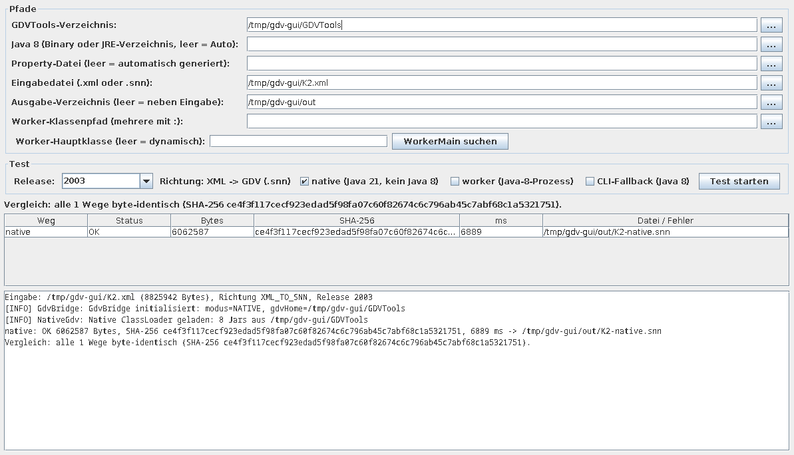

# GDV Converter Bridge

Ruft den GDV-XMLKonverter (GDVTools, `sn.SN_XMLKonverter`) aus einem Java-21-Programm auf
(Linux **und Windows**). Drei Betriebsarten:

- **native** (empfohlen): Konvertierung im Java-21-Prozess, in-memory, **kein Java 8 noetig**
- **worker**: persistenter Java-8-Prozess mit binaerem Stream-Protokoll
- **cli**: Java-8-Kindprozess pro Aufruf ueber Temp-Dateien (Fallback)

## Voraussetzungen

- JDK 21+ (Client), fuer worker/cli zusaetzlich ein Java-8-JRE
- GDVTools entpackt, z. B. `/opt/gdv/GDVTools` bzw. `C:\gdv\GDVTools`

## Aufruf (Datei)

```bash
java -cp gdv-client/target/classes de.prometheus.gdv.Main \
  --gdv-home /opt/gdv/GDVTools \
  --java8    /opt/jdk8/bin/java \
  --in       beispiel.xml \
  --out      beispiel.snn \
  --release  2000
```

Richtung ergibt sich aus der Endung der Eingabedatei (`.xml` -> `.snn`, `.snn` -> `.xml`).

## Native Modus (Java 21, ohne Java 8)

Der Konvertierungskern laeuft auch unter Java 21 - solange das Ergebnis in den Speicher
geschrieben wird. Direktes Schreiben in einen `FileOutputStream` liefert unter Java 21 eine
leere Datei (siehe `.specify/tasks.md`). Der native Modus konvertiert daher in-memory:

```bash
java -cp gdv-client/target/classes de.prometheus.gdv.Main \
  --native --gdv-home /opt/gdv/GDVTools \
  --in beispiel.xml --out beispiel.snn --release 2003
```

Damit wird kein Java-8-Prozess benoetigt; die GDV-Klassen werden in einem eigenen
ClassLoader geladen. Verifiziert: Release 2003 und 2000 byte-identisch zum Java-8-Weg.

## Stream-Betrieb (ohne Temp-Dateien)

```bash
java -cp gdv-client/target/classes de.prometheus.gdv.Main \
  --gdv-home  /opt/gdv/GDVTools \
  --java8     /opt/jdk8/bin/java \
  --worker-cp gdv-worker/target/classes \
  --in        beispiel.xml \
  --out       beispiel.snn \
  --release   2003
```

Protokoll des Workers:
`CONVERT <release> <XML|SNN> <len>` + Nutzdaten -> `OK <len>` + Nutzdaten oder `ERR <text>`.

### Worker-Klassen in anderen Projekten/Packages (dynamische Hauptklasse)

Die Worker-Klassen koennen in ein eigenes Projekt mit beliebigem Package verschoben
werden. Der Client hardcodet den Package-Namen nicht mehr:

- `--worker-cp` akzeptiert einen **kompletten Klassenpfad** mit mehreren Eintraegen,
  getrennt durch das plattformspezifische Zeichen (Linux `:`, Windows `;`).
- Die Hauptklasse wird darin **dynamisch gesucht**: jede Klasse mit dem einfachen Namen
  `WorkerMain` in Verzeichnissen und Jars des Klassenpfads (`WorkerMainFinder`).
  Der vollqualifizierte Name wird aus dem Pfad abgeleitet und dem Java-8-Prozess mitgegeben.
- Explizite Vorgabe (z. B. bei umbenannter Klasse oder mehreren Treffern):
  `--worker-main com.firma.gdv.WorkerMain` oder System-Property `-Dgdv.worker.main=...`.
- Bei mehreren `WorkerMain`-Treffern gewinnt das Original-Package
  `de.prometheus.gdv.worker.WorkerMain`, sonst ein eindeutiger Treffer mit `gdv` im
  Package; andernfalls Fehler mit Kandidatenliste.

Die GDV-Jars (`GDV-Schadennetz.jar` + `lib/*.jar`) haengt der Client automatisch an den
Worker-Klassenpfad an - sie muessen nicht in `--worker-cp` stehen.

## Windows

**Feldtest bestaetigt:** v0.2.2 laeuft auf Windows (Georg Seher, 19.11.2026, "klappt danke").

**Property-Dateien (v0.2.2):** Der Vendor-Parser liest Properties-Style-Escapes. Die von der
Bridge generierte Property-Datei schreibt Windows-Pfade deshalb mit **verdoppelten Backslashes**
(wie die mitgelieferte `konfig/konverter.property` des Vendors: `schemaPath=konfig\\xml\\`).
Einfache Backslashes werden sonst gefressen (`C:\Tools\konfig\xml` -> `C:Toolskonfigxml`) und
der Konverter wirft `FileNotFoundException: ...konfigxml\gdv2003.xsd` / "Keine Header-Definition
in Schema vorhanden!". Unit-getestet via `Properties.load`-Rundlauf (WindowsPropsTest).

**Versionierte Jars (v0.2.2):** Das GDV-Hauptjar wird als `GDV-Schadennetz.jar` gesucht, sonst
`GDV-Schadennetz*.jar` im GDVTools-Verzeichnis oder in `lib/` (exakter Name hat Vorrang). Die
lib-Jars werden unabhaengig von Versionsnummern im Dateinamen enumeriert.

- Klassenpfade werden **ohne Wildcards** aufgebaut: `lib/*.jar` wird einzeln enumeriert.
  Ein Eintrag wie `lib\*` wird nur vom java-Launcher expandiert, nicht von jedem
  ClassLoader/Pfadkonsumenten - die Enumeration funktioniert ueberall.
- Trennzeichen ist immer `File.pathSeparator` (`;` unter Windows, `:` unter Linux).
- Das Java-8-Binary wird plattformgerecht aufgeloest (`java.exe` unter Windows);
  `--java8 C:\gdv\jre8` (Verzeichnis) oder `--java8 C:\gdv\jre8\bin\java` funktionieren beide.
- Pfade mit Leerzeichen sind ok (ProcessBuilder-Argumente, kein Shell-Quoting noetig).

```bat
java -cp gdv-client\target\classes de.prometheus.gdv.Main ^
  --native --gdv-home C:\gdv\GDVTools ^
  --in beispiel.xml --out beispiel.snn --release 2003
```

## Java-8-JRE fuer Spring Boot: wohin damit?

**Nicht ins Fat-Jar.** Ein eingebettetes JRE liegt als verschachtelter Eintrag im Jar und
kann nicht als Prozess gestartet werden. Empfehlung:

1. JRE **ausserhalb** der Anwendung ablegen, z. B. `<app-verzeichnis>/jre8/` oder ein
   fester Pfad wie `C:\gdv\jre8` (Windows) bzw. `/opt/gdv/jre8` (Linux).
2. Pfad konfigurierbar machen - der Client sucht in dieser Reihenfolge:
   `--java8` / Konstruktor-Parameter -> System-Property `gdv.java8` ->
   Umgebungsvariable `GDV_JAVA8` -> `jre8/`, `jre/`, `java8/` neben GDVTools bzw. im
   Arbeitsverzeichnis. In Spring Boot also z. B. `application.properties`:
   `gdv.java8=${GDV_JAVA8:}` bzw. `-Dgdv.java8=...` beim Start.
3. **Am einfachsten: nativen Modus nutzen** (`GdvBridge.nativeMode(gdvHome)`). Dann wird
   ueberhaupt kein Java 8 mehr gebraucht - nur das entpackte GDVTools-Verzeichnis.

## Logging

`java.util.logging` (JUL), keine externe Abhaengigkeit:

- Fehler werden mit **Stacktrace** auf `SEVERE` protokolliert (Datei-/Stream-Konvertierung,
  Worker-Start, GDV-CLI, native Initialisierung).
- Worker-**stderr** wird nicht mehr verworfen: ein Hintergrund-Thread liest ihn,
  protokolliert jede Zeile (`WARNING`, Prefix `[worker-stderr]`) und haelt die letzten
  60 Zeilen fuer Fehlermeldungen vor (z. B. wenn der Worker nicht auf PING antwortet).
- Der Worker selbst schreibt Fehler-Stacktraces auf stderr (stdout gehoert exklusiv dem
  Protokoll) - sie landen damit im Client-Log.
- **Log-Datei:** `--log-file pfad/zur.log` (CLI-Starter) bzw. `-Dgdv.log.file=...` /
  `$GDV_LOG_FILE` (auch als Spring-Boot-Property nutzbar) schreibt das JUL-Log zusaetzlich
  in eine Datei (append, `SimpleFormatter`). Konsolen-Logging bleibt unveraendert.
- Stille Fehler gibt es nicht mehr: auch "erfolgreich" aussehende 0-Byte-Ausgaben
  (bekannter Vendor-Defekt unter Java 21) werden als Fehler protokolliert und abgebrochen.
- Spring Boot: JUL ueber `jul-to-slf4j` (`SLF4JBridgeHandler.install()`) an das
  App-Logging anbinden; Logger-Name `de.prometheus.gdv`.

## Bibliothek

```java
// nativ (kein Java 8):
try (GdvBridge bridge = GdvBridge.nativeMode(Path.of("C:\\gdv\\GDVTools"))) {
    byte[] snn = bridge.convertStream(xmlBytes, "2003", Direction.XML_TO_SNN);
}

// Worker mit externem Klassenpfad / verschobenem Package:
try (GdvBridge bridge = new GdvBridge(Path.of("/opt/gdv/GDVTools"), Path.of("/opt/jdk8/bin/java"),
                                      null, List.of(Path.of("mein-worker.jar")))) {
    bridge.convertFile(in, out, "2000");
}

// Hauptklasse explizit (optional):
new GdvBridge(gdvHome, java8, null, workerCp, "com.firma.gdv.WorkerMain");
```

## Test-GUI (Mini-GUI fuer alle Wege)



Swing-Oberflaeche ohne externe Abhaengigkeiten: alle Pfade eintragbar (GDVTools, Java 8,
Property-Datei, Eingabe, Ausgabe-Verzeichnis, Worker-Klassenpfad, Worker-Hauptklasse),
Wege native / worker / CLI einzeln oder gemeinsam testbar. Ergebnis je Weg: Bytes,
SHA-256, Dauer; danach Byte-Vergleich aller erfolgreichen Wege. JUL-Log der Bridge wird
live in der GUI angezeigt (inkl. Worker-stderr). Einstellungen werden in
`~/.gdv-bridge-gui.properties` gespeichert und beim Start geladen.

```bash
java -cp gdv-client-0.2.2.jar de.prometheus.gdv.TestGui
# oder ueber den CLI-Starter:
java -cp gdv-client-0.2.2.jar de.prometheus.gdv.Main --gui
```

- "WorkerMain suchen" scannt den eingetragenen Klassenpfad (WorkerMainFinder) und traegt
  den Kandidaten bei eindeutigem Treffer automatisch ein.
- Richtung wird aus der Endung der Eingabedatei erkannt (.xml -> .snn, .snn -> .xml).
- Ausgabedateien: `<basis>-<modus>.<endung>` im Ausgabe-Verzeichnis (leer = neben der Eingabe).

Headless (Server/CI, ohne Display) gibt es denselben Test als `--selftest`:

```bash
java -cp gdv-client-0.2.2.jar de.prometheus.gdv.TestGui --selftest \
    --gdv-home /opt/gdv/GDVTools --in beispiel.xml --release 2003 \
    --modes native,worker,cli --java8 /opt/gdv/jre8 \
    --worker-cp gdv-worker-0.2.2.jar --out-dir /tmp/gdv-test
```

Exit 0 nur wenn alle gewaehlten Wege erfolgreich und byte-identisch sind; sonst Exit 1
(Parameterfehler: Exit 2). Ohne Display und ohne `--selftest` meldet die GUI einen Hinweis
und beendet sich mit Exit 2.

## Build & Tests

```bash
mvn -B clean package -Dgdv.home=/opt/gdv/GDVTools          # GDVTools nur lokal, nicht im Repo
mvn -B test -Dgdv.home=... -Dgdv.java8=... \
    -Dgdv.test.xml=beispiel.xml -Dgdv.worker.cp=gdv-worker/target/classes
```

Integrationstests skippen automatisch (assumeTrue), wenn GDVTools/JDK 8/Testdatei fehlen.
GDVTools und Beispieldaten sind bewusst nicht im Repo (GDV-Copyright bzw. interne Daten).

Siehe `.specify/spec.md`, `.specify/plan.md`, `.specify/tasks.md`.

## Rueckweg (.snn -> .xml) - Befunde

- Der 3. Parameter von `gdv.XmlGdvKonverter.convertToXml(in, out, arg3)` ist die
  **Ausgabe-Codierung**, nicht das Release. Die Bridge uebergibt `null` (Vendor-Default,
  byte-identisch zum GDV-CLI-Weg). Eine Release-Angabe als Codierung erzeugt
  `LSException: unsupported-encoding`.
- Verifiziert (Release 2000, RITA_2): worker und CLI byte-identisch (47.262 Bytes).
  Native (Java 21) ist DOM-identisch; einziges Delta ist ein Newline nach der
  XML-Deklaration (47.261 Bytes, JDK-Serializer vs. Xerces).
- **Vendor-Grenze:** Release 2003 Rueckweg der 8,8-MB-Beispieldatei wirft auch unter
  Java 8 eine NPE im GDV-Code (`DatensatzContainerListe2003`, `satzartName` null).
  Das ist kein Bridge-Fehler; Release 2000 funktioniert.
